<p align="center">
  <a href="https://brahma.asherin.com">
    
  </a>
</p>

<h1 align="center">brahma</h1>

<p align="center">
  <b>a photoshop-class image editor, rebuilt from scratch in pure rust.</b><br>
  layers, masks, adjustment layers, layer styles, type, vectors, brushes and real psd files:<br>
  native on desktop, the same engine in your browser. open source, offline, and yours.
</p>

<p align="center">
  <a href="https://brahma.asherin.com"></a>
</p>

<p align="center">
  
  
  
  
  
</p>

<p align="center">
  <a href="#download"><b>download</b></a> ·
  <a href="https://brahma.asherin.com"><b>web app</b></a> ·
  <a href="#previews">previews</a> ·
  <a href="#capabilities">capabilities</a> ·
  <a href="#get-started">get started</a> ·
  <a href="#built-for-agents">agents</a> ·
  <a href="https://github.com/iamaureon74/aureon.brahma/issues">issues</a> ·
  <a href="https://discord.gg/YweZ6PZmnx">#houseofasher community</a>
</p>

<br>

<p align="center">
  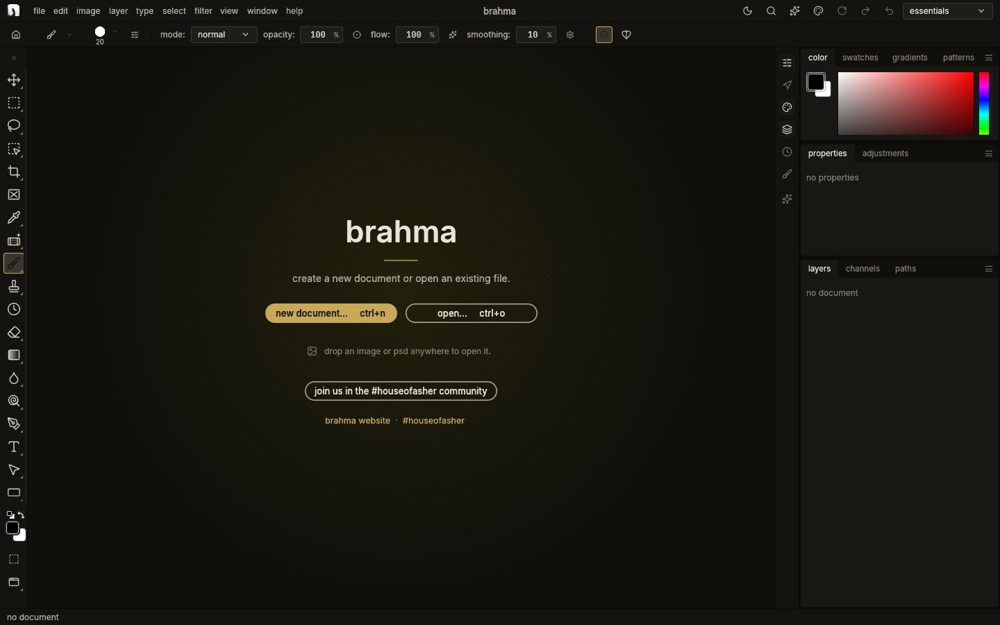
  <br>
  <sub>the home screen, live in the browser at brahma.asherin.com</sub>
</p>

<br>

## download

one click, then open the file. every file is built by github actions from this repository's code, with a checksum and a signed build record (see [verify your download](#verify-your-download)).

<table>
  <tr>
    <td align="center" width="25%">
      <h3>🪟 windows</h3>
      <a href="https://github.com/iamaureon74/aureon.brahma/releases/latest/download/brahma-windows-x64-setup.msi"></a><br><br>
      <a href="https://github.com/iamaureon74/aureon.brahma/releases/latest/download/brahma-windows-x64-portable.zip">portable zip (no install)</a><br>
      <sub>64-bit intel / amd</sub>
    </td>
    <td align="center" width="25%">
      <h3>🐧 linux</h3>
      <a href="https://github.com/iamaureon74/aureon.brahma/releases/latest/download/brahma-linux-x86_64.AppImage"></a><br><br>
      <a href="https://github.com/iamaureon74/aureon.brahma/releases/latest/download/brahma-linux-aarch64.AppImage">arm64 appimage</a> ·
      <a href="https://github.com/iamaureon74/aureon.brahma/releases/latest/download/brahma-linux-x86_64.tar.gz">x86_64 tar.gz</a> ·
      <a href="https://github.com/iamaureon74/aureon.brahma/releases/latest/download/brahma-linux-aarch64.tar.gz">arm64 tar.gz</a><br>
      <sub>any distribution with glibc 2.35+</sub>
    </td>
    <td align="center" width="25%">
      <h3>📱 iphone &amp; ipad</h3>
      <a href="https://brahma.asherin.com"></a><br><br>
      open in <b>safari</b> → share → <b>add to home screen</b><br>
      <sub>full screen, works offline</sub>
    </td>
    <td align="center" width="25%">
      <h3>🤖 android</h3>
      <a href="https://brahma.asherin.com"></a><br><br>
      open in <b>chrome</b> → menu → <b>install app</b><br>
      <sub>full screen, works offline</sub>
    </td>
  </tr>
</table>

<details>
<summary><b>first run, step by step</b></summary>

1. **windows installer:** double-click `brahma-windows-x64-setup.msi`. the files are not code-signed yet, so windows smartscreen may show "windows protected your pc": click **more info → run anyway**. brahma then appears in the start menu.
2. **windows portable:** unzip `brahma-windows-x64-portable.zip` anywhere and run `brahma.exe`. nothing is installed.
3. **linux appimage:** make it executable and run it: `chmod +x brahma-linux-x86_64.AppImage && ./brahma-linux-x86_64.AppImage`. the first run adds brahma to your app menu.
4. **linux tar.gz:** unpack it and run `bin/brahma`, or copy the tree into `/usr/local`.
5. **iphone and ipad:** in safari open [brahma.asherin.com](https://brahma.asherin.com), tap the share button, then **add to home screen**. it opens full screen and works offline after the first visit. apple doesn't allow installing apps from outside the app store, so this web app is the iphone version: the same engine, compiled to webassembly.
6. **android:** in chrome open [brahma.asherin.com](https://brahma.asherin.com), then menu → **install app** (or **add to home screen**). it opens like any other app and works offline.
7. **your own server:** unzip `brahma-web.zip` and host the folder on any static server ([hosting notes](packaging/web/README.md)).

</details>

### verify your download

1. download `SHA256SUMS.txt` from the [latest release](https://github.com/iamaureon74/aureon.brahma/releases/latest) and check: `sha256sum -c SHA256SUMS.txt --ignore-missing` (windows: `Get-FileHash brahma-windows-x64-setup.msi`).
2. or check where the file was built, with the github cli: `gh attestation verify brahma-linux-x86_64.AppImage -R iamaureon74/aureon.brahma`. it proves the file came from this repository's build workflow and was not changed afterwards.

## at a glance

| | |
|---|---|
| **1. familiar by design** | the menus, shortcuts, panels and tools sit where your hands expect them, from ⌘J to ⇧⌘D. if you know photoshop, you already know brahma. |
| **2. native and fast** | a gpu compositor on wgpu (metal, vulkan, dx12, webgpu), copy-on-write tiles and multithreaded filters. no electron, no web view. |
| **3. real psd files** | open, edit and save layered photoshop documents. re-saving keeps the render of 307 of the 309 psd-tools test files. |
| **4. in the browser too** | the whole engine and interface compile to webassembly: installable, works offline, autosaves to the browser. |
| **5. bring your own ai** | an assistant that can run every command and see the canvas, with your own key for any provider. no account, no server of ours. |
| **6. agent-ready** | every action is a command: drive the same engine from the ui, the cli, a json control channel or an mcp server. |

<br>

## previews

every screenshot is the real app, rendered offscreen through its own control channel, on public-domain art or content made in the app.

<table>
  <tr>
    <td width="66%" valign="top" colspan="2">
      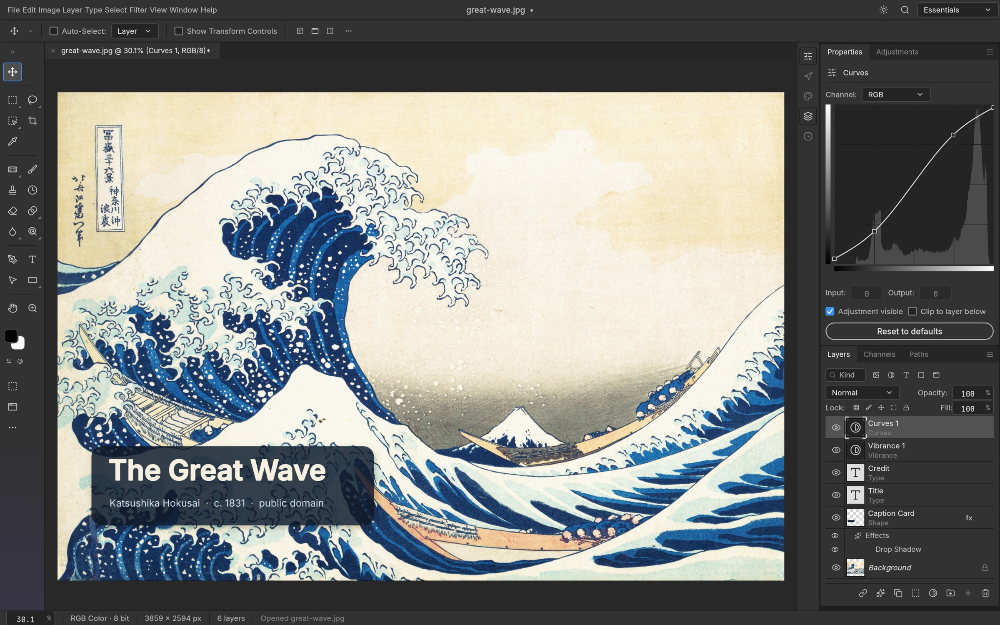
      <br>
      <sub><b>the workspace.</b> a caption card with a drop shadow, live type, and vibrance and curves adjustment layers with the curves editor open. <i>the great wave off kanagawa</i>, katsushika hokusai, c. 1831</sub>
    </td>
    <td width="17%" valign="top">
      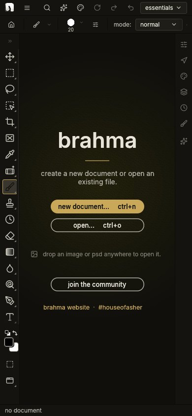
      <br>
      <sub><b>on a phone.</b> the home screen at 390 px.</sub>
    </td>
    <td width="17%" valign="top">
      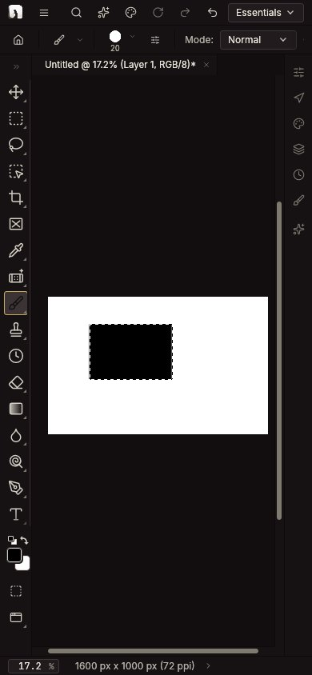
      <br>
      <sub><b>editing on a phone.</b> the canvas with the dock folded away.</sub>
    </td>
  </tr>
  <tr>
    <td width="50%" valign="top" colspan="2">
      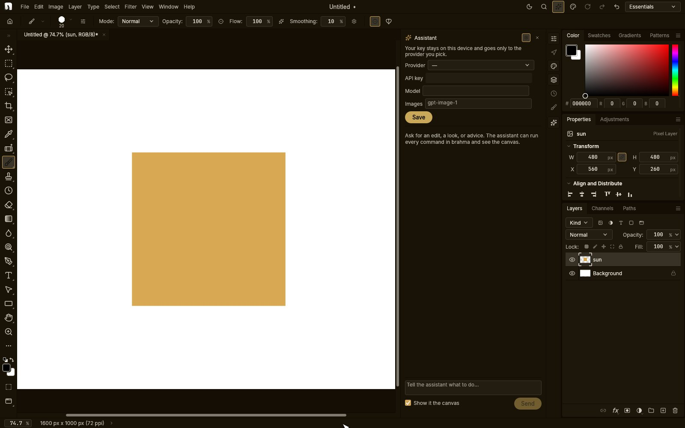
      <br>
      <sub><b>the assistant.</b> bring your own key; it runs brahma's commands and can look at the canvas.</sub>
    </td>
    <td width="50%" valign="top" colspan="2">
      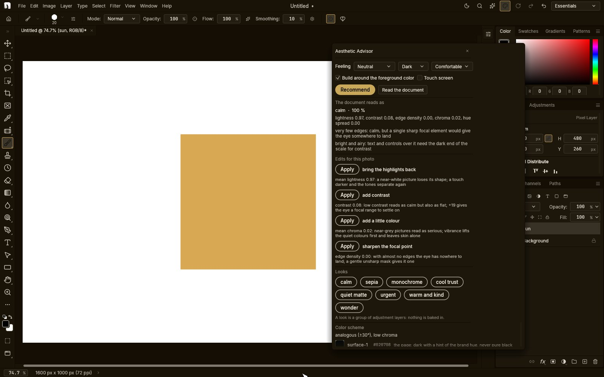
      <br>
      <sub><b>the aesthetic advisor.</b> it measures the picture, explains why, suggests edits and one-click looks.</sub>
    </td>
  </tr>
  <tr>
    <td width="50%" valign="top" colspan="2">
      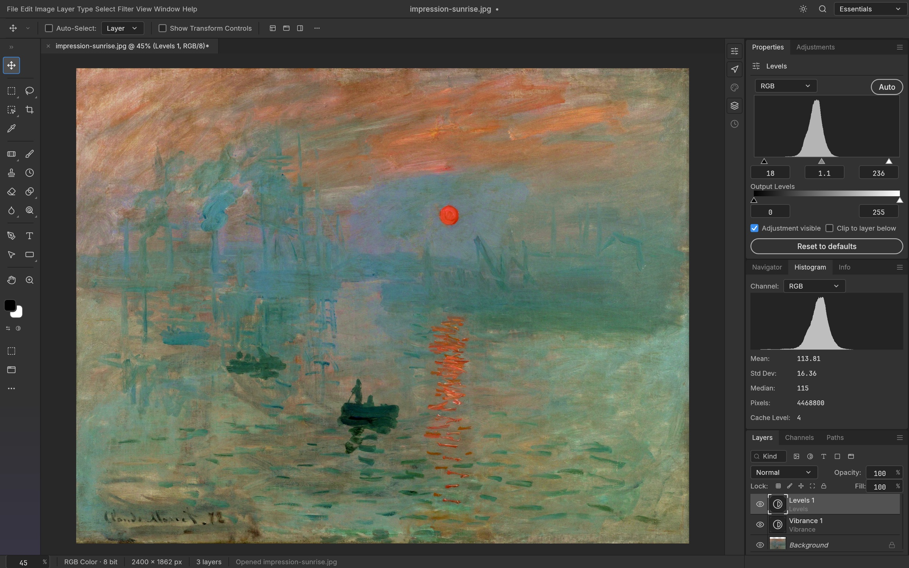
      <br>
      <sub><b>adjustments.</b> levels and vibrance layers with the live histogram. <i>impression, sunrise</i>, claude monet, 1872</sub>
    </td>
    <td width="50%" valign="top" colspan="2">
      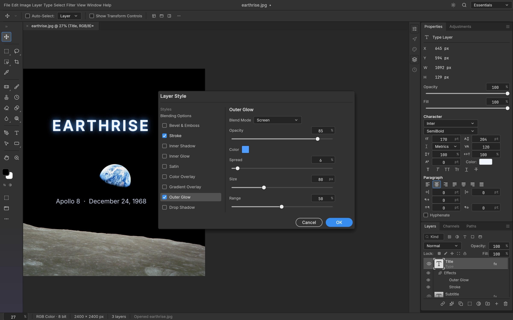
      <br>
      <sub><b>layer styles.</b> outer glow and stroke on live type. <i>earthrise</i>, william anders / nasa, 1968</sub>
    </td>
  </tr>
  <tr>
    <td width="50%" valign="top" colspan="2">
      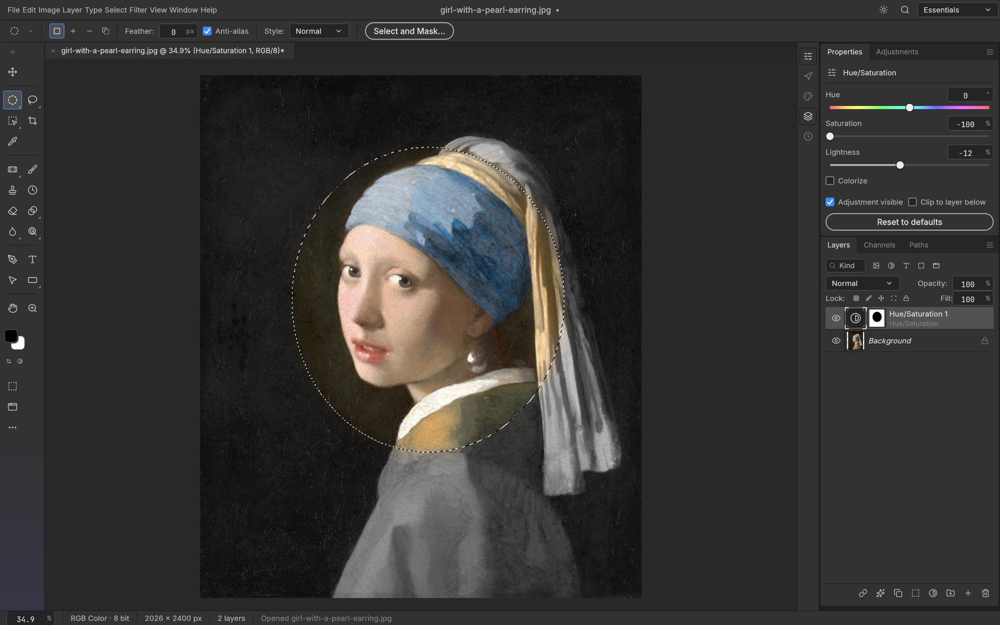
      <br>
      <sub><b>masks.</b> a selection becomes the mask of a hue/saturation layer. <i>girl with a pearl earring</i>, johannes vermeer, c. 1665</sub>
    </td>
    <td width="50%" valign="top" colspan="2">
      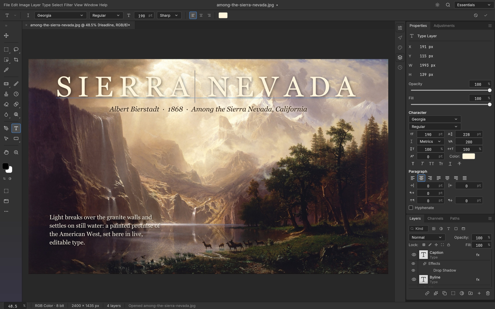
      <br>
      <sub><b>type.</b> a headline edited in place, with a byline and body text. <i>among the sierra nevada</i>, albert bierstadt, 1868</sub>
    </td>
  </tr>
  <tr>
    <td width="50%" valign="top" colspan="2">
      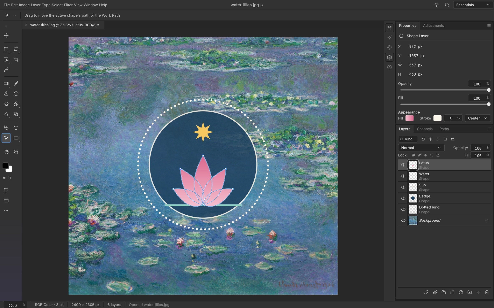
      <br>
      <sub><b>vectors.</b> a badge made of shape layers. <i>water lilies</i>, claude monet, 1906</sub>
    </td>
    <td width="50%" valign="top" colspan="2">
      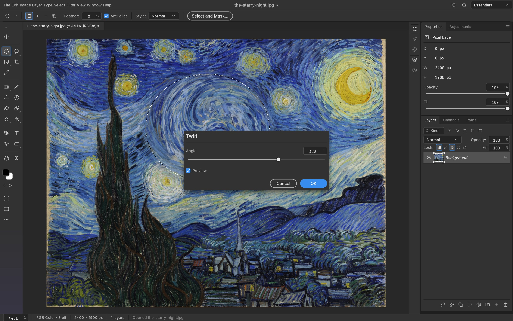
      <br>
      <sub><b>filters.</b> twirl previews live inside the selection. <i>the starry night</i>, vincent van gogh, 1889</sub>
    </td>
  </tr>
  <tr>
    <td width="50%" valign="top" colspan="2">
      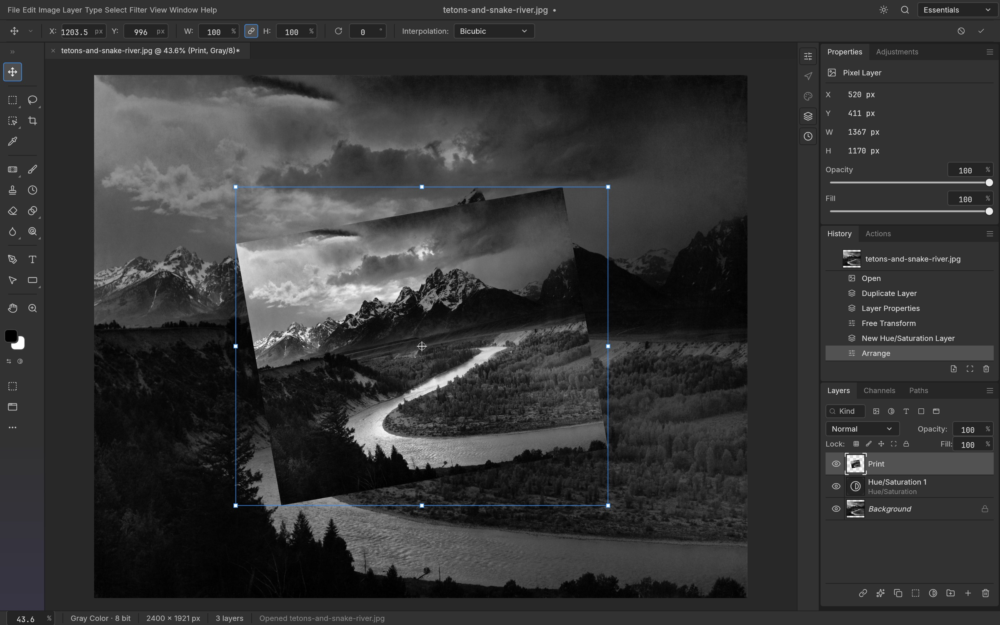
      <br>
      <sub><b>transform and history.</b> every step listed and undoable. <i>the tetons and the snake river</i>, ansel adams, 1942</sub>
    </td>
    <td width="50%" valign="top" colspan="2">
      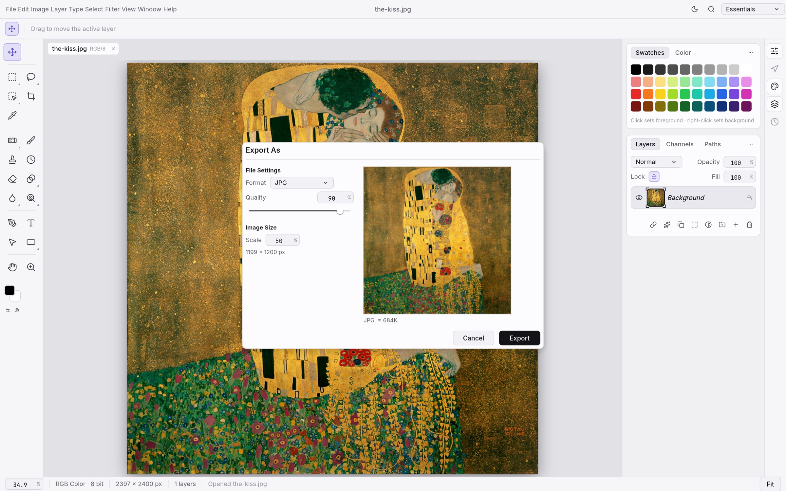
      <br>
      <sub><b>export, light theme.</b> a preview and a file-size estimate. <i>the kiss</i>, gustav klimt, 1907–1908</sub>
    </td>
  </tr>
  <tr>
    <td width="100%" valign="top" colspan="4">
      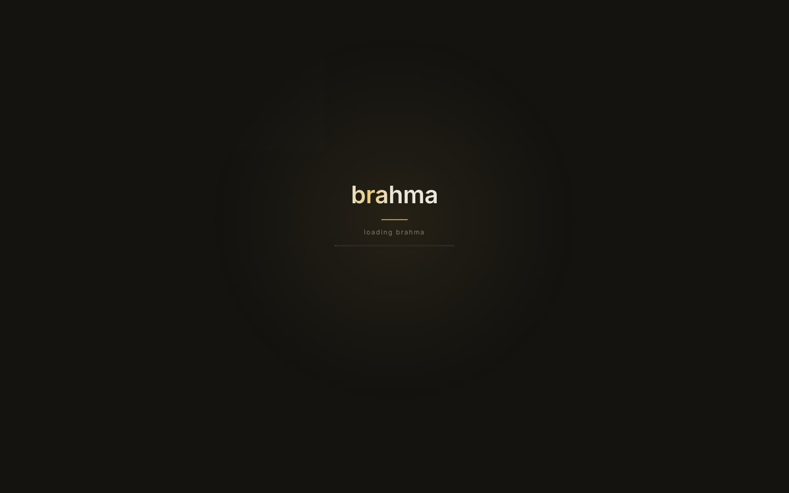
      <br>
      <sub><b>the wait, in motion.</b> while the web app downloads, the name rises, a gold sweep crosses it and the bar shows the real bytes received. all motion stops for people who ask their system for reduced motion.</sub>
    </td>
  </tr>
</table>

<br>

## capabilities

### 1. editing without regret

1. **16 adjustment layers** that keep every edit live, and also apply straight to pixels: curves with per-channel editing, levels with a live histogram, vibrance, hue/saturation, black &amp; white, channel mixer, gradient map, photo filter, selective color and color lookup (`.cube`, `.3dl`, `.look`).
2. **more image adjustments:** shadows/highlights, replace color, match color, hdr toning, desaturate and equalize.
3. **mask, reorder or switch off** any adjustment; your original pixels never change.

### 2. layer styles

1. drop shadow, inner shadow, outer and inner glow, bevel &amp; emboss, satin, stroke, and color, gradient and pattern overlay, live on any layer, type included.
2. a pattern library: built-ins, edit › define pattern, `.pat` import and export, and psd `Patt` blocks.
3. copy and paste styles between layers, hide all effects at once, open styles straight from psds, rendered to match photoshop.

### 3. selections and masks

1. marquees, lassos and the magic wand for precision.
2. quick selection, object selection, select subject, select sky and select background when you want the computer to trace, on your machine, with no cloud and no account.
3. select and mask for hair-fine edges; feather, expand, contract, smooth, grow and reselect.
4. turn any selection into a layer mask, a vector path or a shape.

### 4. type

1. point and paragraph text edited on the canvas, with full character and paragraph controls.
2. variable-font axes, text on a path and warped text.
3. the [type color picker](docs/color-picker.md) with screen sampling and a pixel loupe.
4. type layers stay editable, take layer styles and round-trip through psd.
5. every font the google fonts catalogue can legally serve (about 1,800 families), loaded on demand, plus your system fonts.

### 5. vectors

1. rectangle, ellipse, triangle, polygon, line, pen, freeform pen and curvature pen.
2. resolution-independent shape layers with gradient fills and dashed, aligned strokes.
3. unite, subtract, intersect and exclude; paths as vector masks, strokes or fills.
4. 116 of 116 shape layers in our psd corpus match photoshop's pixels.

### 6. filters

1. every filter dialog previews live on the canvas, through your selection.
2. blurs (gaussian, box, motion, radial, surface, smart, lens, shape, and the blur gallery: tilt-shift, iris, field, spin, path), sharpening, reduce noise, distortions (twirl, wave, ripple, displace, shear, zig zag…), pixelate, stylize (oil paint, wind, extrude…) and render (clouds, fibers, lens flare, lighting effects).
3. filters on a smart object stay editable: change, hide, reorder or mask them any time.
4. large-radius blurs use running-sum box passes across all cores: a radius-180 gaussian on 3.6 mp takes under a second.

### 7. retouching

1. content-aware fill, spot healing, healing brush, patch, content-aware move and red eye.
2. one-click remove object and remove background.

### 8. transform and history

1. free transform with scale, rotate, skew, distort and perspective; exact rotations and flips; transform again.
2. layers, type, shapes, masks and selections all transform together.
3. full history, toggle last state and the history brush: every step can be undone, down to one brush stroke.

### 9. tools

<h4>🧰 67 tools</h4>
Move · Artboard · Rectangular and Elliptical Marquee · Single Row Marquee · Single Column Marquee · Lasso · Polygonal Lasso · Magnetic Lasso · Object Selection · Quick Selection · Magic Wand · Crop · Perspective Crop · Slice · Slice Select · Frame · Eyedropper · Color Sampler · Ruler · Note · Count · Remove · Spot Healing Brush · Healing Brush · Patch · Content-Aware Move · Red Eye · Brush · Pencil · Mixer Brush · Color Replacement · Clone Stamp · Pattern Stamp · History Brush · Eraser · Background Eraser · Magic Eraser · Gradient · Paint Bucket · Blur · Sharpen · Smudge · Dodge · Burn · Sponge · Pen · Freeform Pen · Curvature Pen · Add Anchor Point · Delete Anchor Point · Convert Point · Horizontal and Vertical Type · Horizontal and Vertical Type Mask · Path Selection · Direct Selection · Rectangle · Ellipse · Triangle · Polygon · Line · Custom Shape · Hand · Rotate View · Zoom

### 10. a real brush engine

1. shape dynamics, scattering, texture, dual brush, color dynamics, transfer, brush pose, wet edges, build-up and smoothing (including pulled string).
2. driven by pen pressure, tilt, rotation and direction, with native tablet input on macos and x11.
3. brush presets, define brush from selection, and deterministic, replayable strokes.

### 11. layers, done properly

1. groups, clipping masks, pixel and vector masks, and fill layers (solid, gradient, pattern).
2. live smart objects with smart filters and lossless transforms and warps.
3. multi-layer selection with align, distribute and link; alpha channels and quick mask.
4. 27 photoshop blend modes plus six paint.net variants; opacity and fill, locks, colour labels, a kind filter.
5. merge, flatten, rasterize, layer via copy or cut, paste into, and renaming a document from its tab.

### 12. any colour, any depth

1. rgb, grayscale, cmyk and lab documents at 8, 16 and 32 bits per channel: every tool works at every depth.
2. real icc colour management in pure rust: embedded profiles, assign and convert to profile with all four rendering intents and black point compensation.
3. soft proofing (⌘Y) and gamut warning (⇧⌘Y) on the gpu, and a colour-managed canvas in the browser too.

### 13. formats

1. **layered:** psd and psb, layered tiff (either byte order), the native `.pcraft` format, [openraster](docs/ora.md) (read and write), [paint.net pdn3](docs/pdn.md) (read), [krita `.kra`](docs/kra.md) (read) and affinity documents (`.af`, `.afdesign`, `.afphoto`, `.afpub`, read only).
2. **vector:** svg opens as shape layers or places as a vector smart object.
3. **flat:** png, jpeg, tiff, webp (lossy and lossless), gif, bmp, tga, ico, qoi, pnm, openexr, radiance hdr and fits, each at the depths it supports.
4. **phone photos:** heic from iphone and mac, read only (in official builds; `--features heif` for source builds). avif is write-only with the `avif` feature.
5. details for every format are in the [codec capability matrix](crates/codecs/README.md#capability-matrix-default-build).

### 14. psd without compromise

1. **faithful round trips:** re-saving renders the same for 307 of 309 psd-tools files and 169 of 170 in our mixed ag-psd/psd-tools set; anything not modelled yet is carried over, not dropped.
2. **pixels that match:** a composite oracle compares our render with photoshop's own merged image: gradients, layer effects, shape strokes, clipping and fill opacity.
3. **large documents:** psb, 16 and 32-bit files, and cmyk and lab documents open natively.
4. the standalone `brahma-psd` crate reproduces every parseable corpus file byte for byte.

### 15. the assistant (bring your own ai)

1. a chat that drives the whole app: it can search and run brahma's commands, read the document and look at the canvas.
2. any provider: anthropic, openai, google ai, presets for many regional providers, any openai-compatible endpoint, or a local server (ollama, lm studio).
3. replies stream as they are written, with a stop button; each document keeps its own conversation.
4. image generation through your provider's image model, placed as a new layer.
5. **your keys stay on your device** and go only to the provider you pick. the assistant cannot read or change preferences, plug-ins, scripts or file paths, so a hostile layer name or reply can't reach your keys.

### 16. the aesthetic advisor

1. reads the picture: lightness, contrast, edge density, chroma and hue spread, and the feeling they add up to.
2. explains each suggestion with the measurement behind it, and applies it in one click.
3. one-click looks (calm, sepia, monochrome, cool trust, quiet matte, urgent, warm and kind, wonder) built as adjustment layers, with before and after.
4. recommends colour schemes in oklch, type scales and placement from a research corpus.
5. **adaptive interface:** the interface can take on the open image's dominant hue and a typeface that suits its feeling (preferences › interface).

### 17. interface and motion

1. dark pro, airy studio and classic themes, with a warm dark palette and gold accents.
2. a motion system with one purpose per animation: springs for things that arrive, quick fades for things that leave.
3. a home-screen entrance, a save receipt that shows what you made (name, size, bit depth, format), and a loading screen that shows real download progress.
4. every animation follows preferences › interface › enable animations and the system's reduced-motion setting.
5. layouts that fit phones, tablets and desktops, checked from 320 to 1440 px wide.
6. 21 interface languages.

### 18. the web app

1. the same rust engine and interface compiled to webassembly, at [brahma.asherin.com](https://brahma.asherin.com).
2. installable as an app and works offline after the first visit.
3. browser autosave and crash recovery, so a closed tab doesn't lose your work.
4. large photos decode in a background worker, so the page keeps drawing while they open.
5. paste images straight from the clipboard, and drop files anywhere.

### 19. extend and automate

1. **plug-ins:** sandboxed webassembly plug-ins, a gallery that installs samples in one click, and installs from an https url.
2. **actions:** record and replay, with a visual editor for every step.
3. **batch and droplets:** run one action list over a folder of images.
4. **a local performance log** you can export when something feels slow.

### 20. built for agents

1. one registry of 500+ commands behind every menu item, tool and dialog.
2. a headless cli (`run`, `batch`, `convert`, `info`, `commands`).
3. an mcp server for ai agents, headless or bridged to the running app.
4. an authenticated, loopback-only json control channel that inspects ui state, drives tools with pointer events and takes offscreen screenshots.

### 21. security

1. **never crash:** a malformed file, a bad command or a full disk returns an error, never a panic; an adversarial fuzz test runs every command with hostile parameters.
2. **parsers are hardened:** bounded recursion, checked sizes and capped allocations for every input-derived number.
3. **web:** a strict content security policy with no inline script, subresource integrity on every startup file, hsts, and isolation headers.
4. **automation:** the control channel listens on loopback only, checks a token in constant time and caps request sizes.
5. **no `unsafe`** outside one small, isolated tablet-input crate.
6. see the [security policy](SECURITY.md) and the [security documentation](book/src/security/).

<br>

## built for agents

```sh
# headless: open, edit, save
brahma-cli run wave.psd \
  --cmd filter.sharpen.smartSharpen     --params '{"amount":80}' \
  --cmd layer.newAdjustmentLayer.curves --params '{"points":[[0,0],[64,48],[192,212],[255,255]]}' \
  --out wave-final.png

# apply one action list to a folder of images
brahma-cli batch --actions grade.json --in ./raw --out ./graded

# let an agent drive it over mcp (headless, or bridged to the running app)
brahma-cli mcp
```

the desktop app's control channel (`brahma --control`) is documented in [`docs/control-protocol.md`](docs/control-protocol.md). every image in this readme was rendered through it.

## get started

**in the browser:** open [brahma.asherin.com](https://brahma.asherin.com). nothing to install.

**from source:**

```sh
git clone https://github.com/iamaureon74/aureon.brahma
cd aureon.brahma
cargo run --release -p brahma -- image.psd   # the desktop app
cargo test --workspace                       # the test suite
```

japanese fonts for the ui and the type tool come from craft-fonts, an optional build input; without it brahma uses your system's cjk fonts:

```sh
git clone https://github.com/storytold/craft-fonts ../craft-fonts
CRAFT_FONTS_DIR="$PWD/../craft-fonts" cargo run --release -p brahma
```

**the web build:** `cd apps/brahma-web && trunk build --release`, or self-host it with docker ([docker web hosting](packaging/web/README.md#docker)).

**installers:** ready-made downloads are at the top of this page ([download](#download)). the `Downloads` workflow (`.github/workflows/downloads.yml`, run from the actions tab) builds and publishes them. the packaging scripts can also build signed installers for macos (universal dmg), windows (x64, arm64 and x86 msi and portable zips), linux (appimage, flatpak, deb, rpm and tarballs for x86_64 and aarch64, a riscv64 tarball) and freebsd. how releases are built, signed and published is in [`docs/releasing.md`](docs/releasing.md).

new contributors and ai agents: start with [`AGENTS.md`](AGENTS.md), then [`docs/`](docs/).

## under the hood

1. **engine first:** a pure-data document model and a command engine, with a thin egui interface on top; layering is enforced at build time across the workspace's crates.
2. **two compositors:** a cpu compositor is the reference oracle, a wgpu compositor puts the canvas on the gpu, and they are tested against each other.
3. **copy-on-write tiles:** 256² sparse tiles make undo cheap and huge canvases light.
4. **clean-room:** implemented from public specifications and observed behaviour only; no proprietary code, shaders or assets.
5. **tested:** thousands of tests (more than 2,900 in the interface crate alone), with psd round trips, synthetic generators, compositor oracles and multi-depth checks. real-file corpora are fetched with `cargo xtask corpus --all` and run with `cargo xtask test-corpus` ([details](docs/development.md#test-corpora)).

> [!IMPORTANT]
> **status: early alpha.** much of photoshop's feature surface exists in some form, but **brahma is not yet a photoshop replacement for daily professional work**. the biggest gaps are depth in typography and pro workflows, some missing tools, and plug-in compatibility. every photoshop menu item is wired to a command ([`docs/parity-checklist.md`](docs/parity-checklist.md)), but that measures wiring, not behaviour. the honest picture is in the [roadmap](ROADMAP.md) and the [parity assessment](docs/target-app-parity.md). please [file issues](https://github.com/iamaureon74/aureon.brahma/issues) with your os, document size, layer count and a screenshot.

## documentation

the [brahma documentation book](book/) covers development, architecture, automation, formats and security.

## founders notes from asher

> "for there are over 21M orphans alive today, for many people whom have kids, if you could adopt 1 orphan off the street, raise them correctly and provide and love them as your own son or daughter, for they had a rough life and they did not ask to become an orphan, for there is a diffrence between mom and mother, and dad and father, and child and son or daughter"
>
> — asher

<sub>also in the app: help › founders notes from asher.</sub>

## #houseofasher

brahma is made by #houseofasher: free, open-source creative tools, each written from scratch in rust, native on macos, windows and linux, in the browser through webassembly, and fully drivable by agents.

<h3 align="center">come make things with us</h3>

<p align="center">
  people who paint, shoot, draw, cut film, set type, make music and games, and people still figuring out what they like to make.<br>
  share what you're working on, ask for help, tell us what's broken or what you wish these tools could do.
</p>

<p align="center">
  <a href="https://discord.gg/YweZ6PZmnx"><b>join the #houseofasher community</b></a> ·
  <a href="https://brahma.asherin.com">brahma.asherin.com</a> ·
  <a href="https://github.com/iamaureon74/aureon.brahma">github.com/iamaureon74/aureon.brahma</a>
</p>

---

## license and credits

brahma is dual-licensed under [MIT](LICENSE-MIT) or [apache-2.0](LICENSE-APACHE), at your option.
copyright (c) 2026 #houseofasher and the brahma contributors. required notices are in [NOTICE](NOTICE).

bundled fonts, icons, images and other assets keep their own open licenses; each is listed with its author, source and license in [ATTRIBUTION.md](ATTRIBUTION.md). every artwork shown is in the public domain; sources are in [`docs/images/SOURCES.md`](docs/images/SOURCES.md).

<sub>adobe, photoshop, illustrator, premiere pro, lightroom, acrobat, after effects and indesign are trademarks or registered trademarks of adobe inc. in the united states and/or other countries. brahma is an independent, open-source project and is not affiliated with, sponsored by or endorsed by adobe inc.; these names are used only to describe the workflows it is compatible with.</sub>
